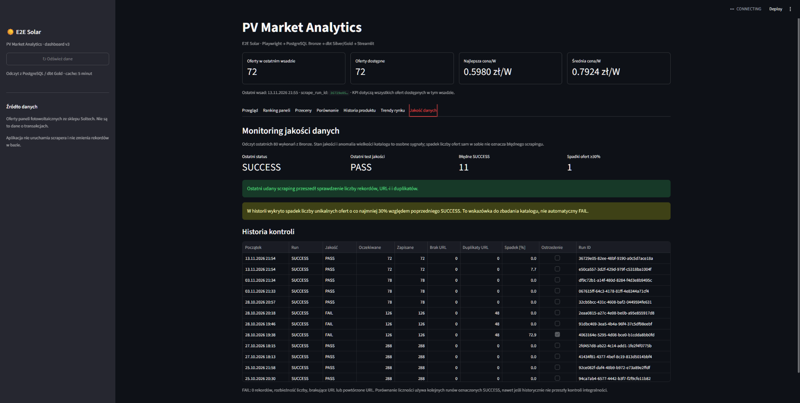
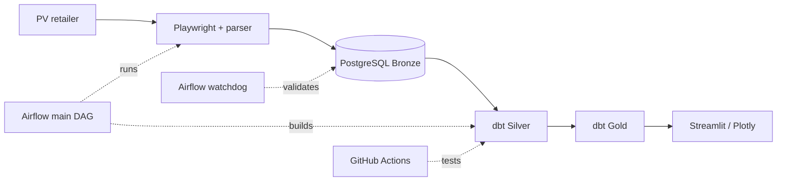

# E2E Solar Price Pipeline

[](https://github.com/Dragozden/E2E-Solar-Scrapper/actions/workflows/ci.yml)

**End-to-end Data Engineering portfolio project:** collect photovoltaic panel offers, preserve their price history, validate data quality, transform records with dbt and explore the results in an interactive dashboard.

**Stack:** Python · Playwright · PostgreSQL 17 · dbt · Apache Airflow · Streamlit · Plotly · Docker Compose · pytest · GitHub Actions

> Local demonstration/development setup, **not an internet-facing production stack**. Observations are retailer listings, not completed transactions or guaranteed inventory.

## Screenshots

| PV panel ranking | Data quality monitoring |
|:--:|:--:|
|  |  |

_Values shown are historical snapshots; actual catalog contents change._

## Capabilities

- **Scraper:** Playwright, dynamic pagination, URL deduplication, offline HTML regression tests.
- **Bronze:** append-only observations with run UUID, timestamps, status and row count.
- **Silver:** dbt typing/validation of raw prices and nominal power.
- **Gold:** current PLN/W ranking, product price history, daily market metrics.
- **Dashboard:** Streamlit/Plotly rankings, price drops, comparison, trends and data quality.
- **Orchestration:** Airflow `solar_el_pipeline` at 00:02 Europe/Warsaw; separate freshness watchdog at 09:00.
- **Quality:** pytest, dbt tests, GitHub Actions Python/dbt/Docker CI; optional webhook failure notifications.
- **Recovery:** PostgreSQL `pg_dump` plus SHA-256 manifests and verified restore into an isolated container.
- **Security:** PostgreSQL dashboard reader role with selected `SELECT` grants; local secrets are untracked and separate from Compose source.

## Architecture



The application dashboard reads Gold views and the minimum Bronze diagnostics through a separate PostgreSQL account. The working database persists in Docker's `postgres_data` volume.

## Quick start (NEW clean clone, EMPTY database volume)

Prerequisites: Git, Docker Desktop/Compose, `uv` and compatible Python/Chromium support. Commands below use Windows PowerShell from the repository root.

```powershell
git clone https://github.com/Dragozden/E2E-Solar-Scrapper.git
cd E2E-Solar-Scrapper
uv sync --frozen

# Generate private root .env and docker/.env with independent random credentials.
# Do NOT run init on a machine with an existing database volume.
uv run --frozen python scripts/local_credentials.py init

# Start only the database; let the official PostgreSQL image initialize the empty volume.
cd docker
docker compose up -d postgres pgadmin
cd ..

# Ingest a real snapshot (contacts the retailer) and build analytic views.
uv run --frozen python -m playwright install chromium
uv run --frozen python -m scraper.main
uvx --env-file .env --python 3.13 --from 'dbt-postgres==1.11.0' dbt build --project-dir dbt/solar_dbt --profiles-dir dbt/solar_dbt

# Grant the dashboard SELECT-only access after Gold models exist.
uv run --frozen python scripts/setup_dashboard_reader.py

cd docker
docker compose up -d --build
docker compose ps
cd ..
uv run --frozen python -m pytest -q
```

| Service | Local address |
|---|---|
| Streamlit | http://localhost:8501 |
| Airflow | http://localhost:8080 |
| pgAdmin | http://localhost:5050 |
| PostgreSQL | `localhost:5432` |

Enable the Airflow DAGs in the local UI. Scheduled jobs require the computer and Docker to be running. **Never run `docker compose down -v`** in the working environment, because it removes persistent data volumes.

## EXISTING installation: credential migration

If you already have a populated PostgreSQL database, **do not run `init`**. Create and verify a fresh backup, then perform the guarded rotation and recreate only the affected services. Read [Local credential rotation](docs/credential_rotation.md) before running any credential-changing command. Changing `POSTGRES_PASSWORD` in the container definition alone does **not** change PostgreSQL's existing role password.

## Data models

| Layer | Object | Meaning |
|---|---|---|
| Bronze | `bronze.scrape_runs` | One row per ingestion run |
| Bronze | `bronze.panel_scrape_raw` | One row per observed offer |
| Silver | `silver.stg_panels` | Typed historical observations from successful runs |
| Gold | `gold.current_panel_ranking` | Current per-product URL offer ranking |
| Gold | `gold.product_price_history` | Product price deltas between successful runs |
| Gold | `gold.daily_market_prices` | Observed available-offer metrics by day |

`PLN/W = offer price / rated power` compares nominal panel power, not electricity yield in kWh. The market average uses a changing product mix, not a fixed-basket index.

## Engineering case study

On 27 October 2026, the scraper observed 288 unique products. On 28 October, only four catalog pages contained 78 unique offers; an older fixed 12-page loop reprocessed six last-page products, producing 126 rows including 48 redundant URL occurrences. The dbt integrity gate correctly rejected the run. Dynamic pagination, deduplication and offline Chromium tests resolved and protect against this class of failure. See [portfolio case study](docs/portfolio.md).

## Testing, recovery and security

```powershell
uv run --frozen python -m pytest -q
uv run --frozen python scripts/security_audit.py --strict
uv run --frozen python scripts/postgres_backup.py create
uv run --frozen python scripts/postgres_backup.py verify
```

Backups and credential files are **not included in Git or Docker images**. A PostgreSQL dump is not encrypted and does not back up Airflow's separate SQLite metadata, pgAdmin state or local secrets. Maintain an additional protected off-machine copy. Localhost-only ports, a reader role and strong passwords do **not** make unauthenticated Streamlit or the development Airflow environment safe to publish directly to the internet.

## Limitations

- Product identity uses the retailer URL; URL changes may fragment historical records.
- Nominal watts come from product titles; power and other technical specs are not independently verified.
- Retailer price gross/net treatment is not independently established.
- Historical timestamps are timezone-naive; UTC migration requires an explicit conversion plan.
- The in-Airflow watchdog cannot send alerts when Airflow or the host itself is stopped.

## Documentation

[Architecture](docs/architecture.md) · [Development](docs/development.md) · [Data dictionary](docs/data_dictionary.md) · [Business logic](docs/business_logic.md) · [Data quality](docs/data_quality.md) · [Alerting](docs/alerting.md) · [CI](docs/ci_cd.md) · [Backups](docs/backups.md) · [Security](docs/security.md) · [Credential rotation](docs/credential_rotation.md) · [Release checklist](docs/release_checklist.md)

## Next steps

Automate scheduled backups with external encrypted storage; validate the clean-clone path and prepare an isolated, authenticated public dashboard demo that does not expose the local PostgreSQL, pgAdmin or Airflow services.
