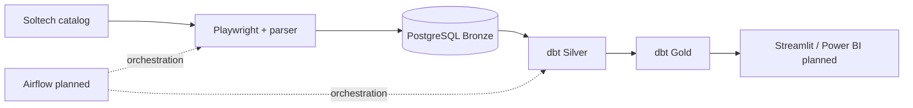

# E2E Solar Price Pipeline

Portfolio pipeline for extracting photovoltaic panel listings and producing analytical models in PostgreSQL.

## Status
- ✅ Playwright-based category extraction and product URL normalization
- ✅ PostgreSQL Bronze (observations + scrape run tracking)
- ✅ Transactional loading and SUCCESS/FAILED status handling
- ✅ dbt Silver staging and Gold current-product ranking
- ✅ Python parser tests and dbt data-quality tests
- 🚧 Price-history and market-trend marts
- 📌 Airflow orchestration / Streamlit or Power BI dashboard — planned, not yet delivered

## Architecture

## Key capabilities
- One `scrape_run_id` per scrape, linked to all captured panel observations.
- Successful runs keep historical observations rather than overwrite prices.
- Silver types price and wattage while keeping history.
- Gold ranks the latest successful snapshot by availability and PLN per watt.

## Quick start
1. Copy `.env.example` to `.env` and enter local PostgreSQL credentials.
2. Start Docker database: `docker compose -f docker/docker-compose.yml up -d`.
3. Install Python dependencies with `uv sync` and `uv run playwright install chromium`.
4. Run `uv run pytest -v` and `uv run python -m scraper.main`.
5. Execute dbt via `uvx --env-file .env --python 3.13 --from "dbt-postgres>=1.10,<2" dbt build --project-dir dbt/solar_dbt --profiles-dir dbt/solar_dbt`.

## Documentation
- [Architecture](docs/architecture.md)
- [Data dictionary](docs/data_dictionary.md)
- [Business logic](docs/business_logic.md)
- [Data quality](docs/data_quality.md)
- [Development](docs/development.md)

## Important limitations
Data are historical snapshots of a retailer's offers, not actual transactions. Scraped prices have not yet been independently verified as gross/net. Wattage is inferred from product titles. The scraper has observed 288 unique offerings in a confirmed successful run, whereas an earlier site counter showed 286; this difference is monitored instead of hard-coded.
