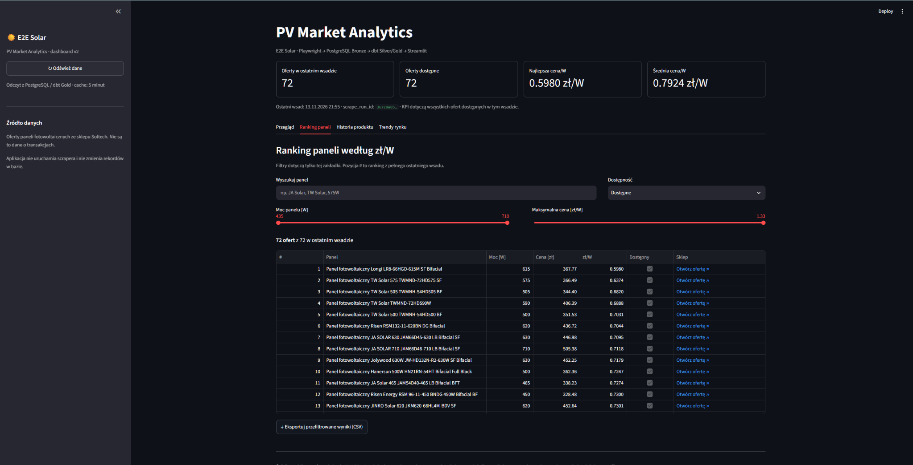
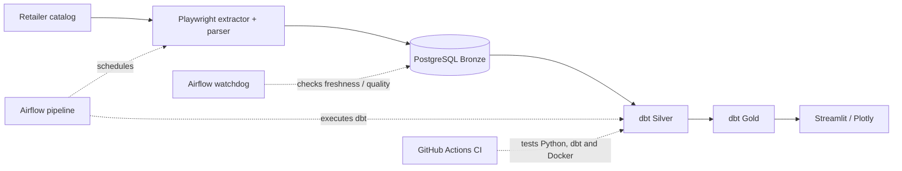

# E2E Solar Price Pipeline

[](https://github.com/Dragozden/E2E-Solar-Scrapper/actions/workflows/ci.yml)

**End-to-end Data Engineering project:** collect photovoltaic panel offers, retain price history, validate data quality, transform data with dbt, and explore the results in an interactive Streamlit dashboard.

**Stack:** Python · Playwright · PostgreSQL 17 · dbt · Apache Airflow · Streamlit · Plotly · Docker Compose · pytest · GitHub Actions

> **Project type:** local portfolio/demo environment, not a production SaaS. The data represent retailer listings, **not transactions** or a guaranteed real-time inventory. A public deployment is not yet provided.

## Screenshots

| PV panel ranking | Scrape quality monitoring |
|:--:|:--:|
|  |  |

_Screenshots show historical local dashboard states. Values and offer counts change with each completed scrape._

## Current capabilities

- **Extraction:** synchronous Playwright scraper follows real pagination links, parses product tiles, and deduplicates product URLs within a run.
- **Bronze:** append-only product observations plus a per-run UUID, start/end timestamps, row count, and status in PostgreSQL.
- **Silver:** dbt cleans/normalizes prices and rated panel power and preserves observations from successful runs.
- **Gold:** current PLN/W ranking, individual product price history, and daily market aggregates.
- **Visualization:** Streamlit dashboards for ranking, historical prices, market trends, price-drop detection, comparison of products, and quality monitoring.
- **Orchestration:** `solar_el_pipeline` runs daily at **00:02 Europe/Warsaw**; `solar_data_watchdog` checks freshness/quality daily at **09:00**.
- **Monitoring:** Airflow failure alerts and optional Discord/Slack webhooks; default stale-snapshot threshold **30 hours**.
- **Testing:** offline Playwright/HTML regression tests, Python unit tests, dbt data tests, and GitHub Actions CI on an isolated PostgreSQL service.

The developer verified **49 passing local tests** after the scraper regression stage (15 November 2026). Further monitoring tests were added subsequently; run `uv run --frozen python -m pytest -q` to see the current count. GitHub Actions runs Python tests, dbt integration, and Docker image/Compose checks.

## How it works



**Main DAG:** `scrape_to_bronze` → `build_dbt_models` → `validate_pipeline`. The Streamlit service uses a separate PostgreSQL role with `SELECT` permissions on selected Gold views and Bronze monitoring tables.

## Quick start (Windows PowerShell)

Requires Git, Docker Desktop with Compose, `uv`, and a compatible Python toolchain. Commands below assume the repository root.

### 1. Get the project and configure the local environment

```powershell
git clone https://github.com/Dragozden/E2E-Solar-Scrapper.git
cd E2E-Solar-Scrapper
uv sync --frozen
Copy-Item .env.example .env
```

Review the root `.env` and make sure its database credentials match your **locally configured** PostgreSQL instance. Do not commit this file. The local Compose database uses development credentials from `docker/docker-compose.yml` unless you change that configuration **and** initialize/set database credentials appropriately.

### 2. Start the database and build analytical views

```powershell
docker compose -f docker/docker-compose.yml up -d postgres pgadmin
uv run --frozen python -m playwright install chromium
uv run --frozen python -m scraper.main
uvx --env-file .env --python 3.13 --from 'dbt-postgres==1.11.0' dbt build --project-dir dbt/solar_dbt --profiles-dir dbt/solar_dbt
```

The scraper contacts the retailer and stores a new snapshot. It requires the retailer to be accessible and its markup to match the parser; the catalog may change. Do **not** run this step simply to test the parser offline — use the pytest fixtures instead.

### 3. Create dashboard read-only credentials and start the full stack

```powershell
uv run --frozen python scripts/setup_dashboard_reader.py
cd docker
docker compose up -d --build
docker compose ps
cd ..
uv run --frozen python -m pytest -q
```

The reader bootstrap expects the three Gold views to exist first. It generates an untracked `dashboard/.env` and validates its permissions. **Do not run `docker compose down -v`: it removes named volumes, including the PostgreSQL history.**

| Service | Local address |
|---|---|
| Streamlit | http://localhost:8501 |
| Airflow | http://localhost:8080 |
| pgAdmin | http://localhost:5050 |
| PostgreSQL | `localhost:5432` |

Start or enable the Airflow DAGs in the local Airflow UI. Scheduled jobs require the Docker environment and host computer to remain running; GitHub Actions CI does **not** operate your local ETL schedule.

For troubleshooting, alternate setup paths, and log locations, see [Development](docs/development.md).

## Data models

| Layer | Table / model | Grain and purpose |
|---|---|---|
| Bronze | `bronze.scrape_runs` | One row per scraping execution |
| Bronze | `bronze.panel_scrape_raw` | One row per saved offer observation |
| Silver | `silver.stg_panels` | Typed historical observations from successful runs |
| Gold | `gold.current_panel_ranking` | One product URL per latest successful run |
| Gold | `gold.product_price_history` | One product URL per successful run with previous price and delta |
| Gold | `gold.daily_market_prices` | Daily summary of observed available offers |

`PLN/W = offer_price_pln / rated_power_w` is an offer-comparison metric, **not** a measure of generated kWh or the lowest lifetime energy cost.

## Engineering case study: pagination regression

On 27 October 2026, the scraper recorded **288 unique offers**. On 28 October, the observed category had **78 unique offers over four pages**, but the then-hardcoded 12-page scraper requested pages beyond the last page, repeatedly encountering six products. It saved **126 rows, 48 redundant URL occurrences**. The dbt integrity test correctly blocked downstream models.

The fix replaced the fixed page count with pagination-link traversal, URL deduplication, and explicit failure on structural anomalies. We then added offline Chromium regression tests so the same failure mode is checked without hitting the live retailer.

Read the [portfolio case study](docs/portfolio.md) for tradeoffs and testing strategy.

## Operational notes and limitations

- Product identity uses retailer `source_url`; URL changes may split the history of a product.
- Title-based regex extracts rated power; module specifications, efficiency, and bifaciality are not independently validated.
- The source price's gross/net tax status has not been independently verified.
- Daily average PLN/W reflects a **changing product basket**, not a fixed-cohort price index.
- Existing timestamps are timezone-naive; migration to UTC `TIMESTAMPTZ` requires a deliberate backfill plan.
- Airflow's embedded SQLite and the local example credentials are intended for development. Do **not** expose this stack publicly as configured.
- The in-Airflow watchdog cannot alert if Airflow itself or its host is shut down.

## Docs

[Architecture](docs/architecture.md) · [Development / Runbook](docs/development.md) · [Data dictionary](docs/data_dictionary.md) · [Business logic](docs/business_logic.md) · [Data quality](docs/data_quality.md) · [Alerting](docs/alerting.md) · [CI/CD](docs/ci_cd.md) · [Release checklist](docs/release_checklist.md)

## Next steps

Use the [release checklist](docs/release_checklist.md) before sharing a hosted demo: test clean-clone setup, remove development credentials, add database backup/restore verification, and design a separate authenticated deployment environment.
