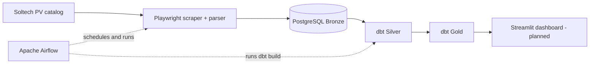

# E2E Solar Price Pipeline

An end-to-end ELT portfolio project that collects photovoltaic panel listings from an online retailer, stores historical observations in PostgreSQL, validates and transforms them with dbt, and orchestrates the workflow with Apache Airflow.

## Project status (28 October 2026)

- ✅ Playwright scraper with **dynamic pagination** and product URL deduplication
- ✅ PostgreSQL **Bronze** observations and per-run tracking (`scrape_run_id`, SUCCESS/FAILED)
- ✅ dbt **Silver** staging and data-quality tests
- ✅ dbt **Gold** marts for current product ranking, price history, and daily market prices
- ✅ Apache Airflow orchestration; full pipeline completed successfully
- ✅ Local Python test suite: **8 passed** (28 October 2026)
- 🚧 Streamlit dashboard — next development stage

## Architecture



## Key capabilities

- Each scrape has a unique `scrape_run_id` associated with all product observations.
- Historical snapshots are preserved rather than overwritten.
- The scraper follows actual pagination links instead of assuming a fixed number of pages.
- Product URLs are deduplicated within each scrape; unexpected empty pages and pagination loops cause explicit errors.
- dbt validates latest-run integrity before building dependent models.
- Silver cleans and types raw data; Gold provides analytical datasets for rankings, historical product prices, and daily market summaries.

## Run locally

The commands below assume Windows PowerShell and the repository root unless otherwise indicated.

1. Create a local `.env` based on `.env.example` and configure the PostgreSQL connection. Do not commit `.env`.
2. Start PostgreSQL, pgAdmin, and Airflow with Docker Compose:

   ```powershell
   cd docker
   docker compose up -d --build
   docker compose config --services
   cd ..
   ```

   Compose automatically loads `docker/docker-compose.override.yml` alongside `docker/docker-compose.yml` when invoked from the `docker` directory.
3. Install the local Python dependencies and Chromium, if not already installed:

   ```powershell
   uv sync
   uv run playwright install chromium
   ```

4. Run the test suite and optionally scrape once outside Airflow:

   ```powershell
   .\.venv\Scripts\python.exe -m pytest -q
   uv run python -m scraper.main
   ```

5. Open Airflow at <http://localhost:8080> and trigger `solar_el_pipeline`, or let the configured daily schedule run it. The DAG uses `schedule="2 0 * * *"`, i.e. **00:02** in its configured `Europe/Warsaw` timezone. A manual DAG run executes the entire pipeline; do not rerun only dbt when validating newly scraped data.

6. To run dbt manually from the repository root:

   ```powershell
   uvx --env-file .env --python 3.13 --from "dbt-postgres>=1.10,<2" dbt build --project-dir dbt/solar_dbt --profiles-dir dbt/solar_dbt
   ```

> **Data safety:** Do not run `docker compose down -v` unless you intentionally want to remove Docker volumes, including PostgreSQL data.

## Analytical models

| Layer | Model / table | Purpose |
|---|---|---|
| Bronze | `bronze.panel_scrape_raw` | Raw product observations from each scrape |
| Bronze | `bronze.scrape_runs` | Run metadata, status and product count |
| Silver | `silver.stg_panels` | Cleaned, typed observations |
| Gold | `gold.current_panel_ranking` | Current product ranking and PLN/W comparison |
| Gold | `gold.product_price_history` | Historical observations and price changes by product |
| Gold | `gold.daily_market_prices` | Daily market-level price metrics |

Example PostgreSQL validation:

```sql
SELECT
    r.started_at,
    r.status,
    r.products_count,
    COUNT(p.scrape_id) AS actual_count,
    COUNT(DISTINCT NULLIF(TRIM(p.source_url), '')) AS unique_urls
FROM bronze.scrape_runs r
LEFT JOIN bronze.panel_scrape_raw p
    ON r.scrape_run_id = p.scrape_run_id
GROUP BY r.scrape_run_id, r.started_at, r.status, r.products_count
ORDER BY r.started_at DESC
LIMIT 10;

SELECT *
FROM gold.daily_market_prices
ORDER BY observation_date DESC;
```

## Data quality and catalog changes

The scraper previously observed **288 unique offers** (27 October 2026). On **28 October 2026**, the retailer's category was observed with **78 unique products across four pages**. The earlier fixed 12-page loop produced repeated offers when requesting pages beyond the end of the catalog. Dynamic pagination and URL deduplication fixed this issue, and the full Airflow/dbt pipeline subsequently completed successfully.

These values describe observed snapshots, **not an expected permanent product count**. Product counts can change as the catalog changes; a successful scrape alone does not prove that every missing historical offer is discontinued. Data-quality checks detect missing or duplicated URLs and inconsistencies between reported and stored row counts.

## Documentation

- [Architecture](docs/architecture.md)
- [Data dictionary](docs/data_dictionary.md)
- [Business logic](docs/business_logic.md)
- [Data quality](docs/data_quality.md)
- [Development](docs/development.md)

## Limitations and next steps

- Listings are retailer offers, not completed transactions. Gross/net price interpretation has not been independently verified.
- Power ratings are inferred from listing titles and may need additional validation.
- Large changes in the catalog should eventually trigger explicit anomaly alerts rather than being interpreted automatically as stock removals.
- A Streamlit dashboard, pagination regression tests and richer run-level monitoring remain planned.
- The Docker Compose configuration currently includes local-development credentials; secure these and restrict exposed services before deploying outside a trusted development machine.
