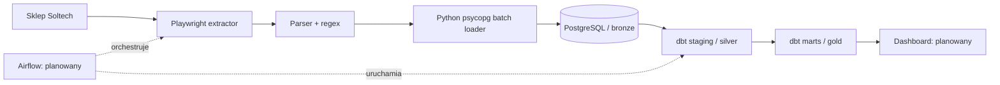

# Architecture — E2E Solar Price Pipeline

## Cel
Portfolio Data Engineering: cykliczne pobieranie ofert paneli fotowoltaicznych, zachowanie historii cen, modelowanie ELT w PostgreSQL/dbt i przygotowanie danych dla dashboardu.

## Działająca część (stan z ostatniego potwierdzenia)

- `scraper.main` generuje `scrape_run_id` raz na wykonanie.
- `scraper.extractor` przegląda kategorię, wybiera wyłącznie sekcję „Lista produktów” i przekazuje `scrape_run_id` dalej.
- `scraper.parser` sprawdza typ produktu, odczytuje dane kafelka i buduje `RawPanel`; moc oblicza regexem z tytułu. URL normalizuje względem domeny.
- `scraper.load` zapisuje obserwacje w jednej transakcji (`executemany`); status runu przechowuje osobno jako `RUNNING`/`SUCCESS`/`FAILED`.
- `dbt/solar_dbt/models/staging/stg_panels.sql` typuje cenę i moc; uwzględnia wyłącznie `SUCCESS`.
- `gold.current_panel_ranking` pokazuje oferty z ostatniego zakończonego poprawnego runu i oblicza cenę za wat.

## Granice odpowiedzialności
- **Extract / Python**: odczyt informacji źródłowych i minimalna walidacja produktu; brak rankingu.
- **Bronze**: obserwacje ofert z historią runów i metadane wykonania.
- **Silver**: typowane, ujednolicone pola, zachowana historia obserwacji z poprawnych runów.
- **Gold**: modele dla konkretnych pytań biznesowych — najnowszy ranking, historia i trendy.
- **Airflow** (plan): orkiestracja, retry, harmonogram i alerty.
- **Streamlit / Power BI** (plan): prezentacja danych z Gold.

## Klucz produktu i historia
- Obserwacja: `scrape_id` (unikalny klucz rekordu).
- Wykonanie: `scrape_run_id` (ten sam identyfikator we wszystkich rekordach jednego scrape'u).
- Tożsamość produktu na etapie MVP: `source_url`. Może wymagać zastąpienia identyfikatorem sklepu, jeśli linki się zmieniają.
- Powtarzające się `source_url` w **różnych** runach są zamierzone; w **jednym** runie są błędem jakości.

## Ograniczenia i backlog
- Na jednym z potwierdzonych wykonań: 288/288 unikalnych URL-i oraz nazw, bez brakujących URL-i; wcześniejsza strona raportowała 286. Rozbieżność wymaga wyjaśnienia lub monitorowania, nie wpisywać 288 jako sztywnego limitu.
- Pole `power_text` pochodzi z regexu na nazwie — nie z osobnego parametru technicznego.
- `efficiency_text` i `bifaciality_text` nie są jeszcze zbierane z kart produktu.
- Cena z atrybutu `price` kafelka: interpretacja brutto/netto nie została osobno potwierdzona; nie deklarować tego w dashboardzie bez weryfikacji.
- Obecne znaczniki czasu to `TIMESTAMP` bez strefy czasowej. Docelowo rozważyć `TIMESTAMPTZ` w UTC.
- Starsze testowe rekordy mogą nie mieć `scrape_run_id`, a starsze wykonania `SUCCESS` nie mieć dopasowanych produktów. Silver celowo filtruje do poprawnie połączonych runów.
