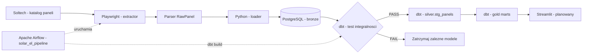

# Architecture — E2E Solar Price Pipeline

> **Stan potwierdzony: 28.10.2026.** Scraper, PostgreSQL Bronze, modele dbt Silver/Gold i orkiestracja Airflow działają w pełnym przebiegu DAG-a. Dashboard Streamlit pozostaje kolejnym etapem.

## Cel systemu

Projekt portfolio z obszaru Data Engineering / ELT. System cyklicznie pobiera oferty paneli fotowoltaicznych z katalogu Soltech, zapisuje obserwacje historyczne, kontroluje ich jakość i przygotowuje dane do analiz cenowych. Dane opisują **oferty sklepu**, a nie transakcje sprzedaży.

## Architektura logiczna

**Uruchomienie lokalne:** `docker/docker-compose.yml` oraz automatycznie dołączany `docker/docker-compose.override.yml` udostępniają usługi `postgres`, `pgadmin` i `airflow`. PostgreSQL przechowuje dane w wolumenie `postgres_data`. Airflow ma osobne wolumeny stanu i logów; repozytorium scrapera, folder DAG i projekt dbt są montowane do kontenera.

## Przepływ danych

1. **Airflow** uruchamia DAG `solar_el_pipeline`: ręcznie lub zgodnie z `schedule="2 0 * * *"`, tj. codziennie o **00:02 w strefie `Europe/Warsaw`** skonfigurowanej w DAG-u. `catchup=False`, `max_active_runs=1`.
2. **`scraper.main`** generuje jeden `scrape_run_id` (UUID) dla całego pobierania i zarządza statusem uruchomienia (`RUNNING` → `SUCCESS` albo `FAILED`).
3. **`scraper.extractor`** używa synchronicznego Playwright. Otwiera sekcję „Lista produktów”, przechodzi po linkach „Następne produkty”, zatrzymuje się na końcu katalogu i deduplikuje produkty według URL. `MAX_PAGES=50` to bezpiecznik, a nie zadana liczba stron.
4. **`scraper.parser`** parsuje kafelki do obiektów `RawPanel`, normalizuje URL i wydobywa moc z tytułu wyrażeniem regularnym.
5. **Loader Pythona** zapisuje obserwacje do `bronze.panel_scrape_raw`; metadane uruchomienia przechowuje `bronze.scrape_runs`. Bronze zachowuje dane z kolejnych uruchomień.
6. **Airflow uruchamia `dbt build`** (`build_dbt_models`). Test `assert_latest_run_integrity` bada ostatni `SUCCESS` — liczność rekordów, kompletność URL i ich unikalność. Przy błędzie powiązane modele są pomijane (`SKIP`), a zadanie Airflow kończy się błędem.
7. **Silver** (`silver.stg_panels`) typuje i normalizuje wartości. **Gold** dostarcza ranking, historię cen i dzienne statystyki rynku.
8. **Streamlit** będzie odczytywać modele Gold; nie jest jeszcze wdrożony.

## Modele i odpowiedzialności

| Warstwa | Zasób | Odpowiedzialność |
|---|---|---|
| Extract | `scraper/extractor.py`, `parser.py` | Pobranie kafelków, parsowanie, dynamiczna paginacja, deduplikacja w pojedynczym runie |
| Bronze | `bronze.scrape_runs` | UUID, czas, status i zadeklarowana liczba produktów |
| Bronze | `bronze.panel_scrape_raw` | Surowe obserwacje z kolejnych runów |
| Silver | `silver.stg_panels` | Typowanie ceny i mocy, zachowanie historii runów `SUCCESS` |
| Gold | `gold.current_panel_ranking` | Ranking ofert z najnowszego poprawnego runu |
| Gold | `gold.product_price_history` | Obserwacje i zmiany cen produktu między runami |
| Gold | `gold.daily_market_prices` | Zestawienie dziennych metryk oferty |
| Orkiestracja | `airflow/dags/solar_pipeline.py` | Harmonogram, zależności zadań, uruchamianie dbt i logi |

W logu `dbt build` z 28.10.2026 wykryto **5 modeli i 15 testów danych**. Oprócz opisanych modeli analitycznych istnieje techniczny model `silver.assert_history_unique_per_run`; jego implementację i dokładną semantykę należy weryfikować w źródłowym SQL.

## Tożsamość i ziarno danych (grain)

- **Run:** jeden `scrape_run_id` na wykonanie scrapera.
- **Obserwacja Bronze/Silver:** jeden `scrape_id` na zapisany rekord oferty.
- **Produkt (MVP):** `source_url` po normalizacji. Jest to praktyczny identyfikator, dopóki sklep nie zmieni adresów produktów.
- **Historia produktu:** ten sam `source_url` może legalnie występować w wielu runach; duplikat w **tym samym** runie jest błędem jakości.
- **Historia Gold:** według kontraktu biznesowego jeden produkt na (`scrape_run_id`, `source_url`).
- **Statystyki dzienne:** agregat po dniu; przy wielokrotnych pomiarach jednego dnia produkt powinien być uwzględniony raz w dziennym przekroju.

## Incydent paginacji — 28.10.2026

W poprzedniej implementacji `TOTAL_PAGES=12` wymuszał odwiedzanie 12 adresów, niezależnie od rzeczywistej długości katalogu. Gdy w katalogu były już tylko **4 strony i 78 unikalnych ofert**, kolejne adresy powtarzały sześć ostatnich produktów. Powstało **126 zapisów, ale tylko 78 różnych URL (48 nadmiarowych wystąpień)**; test `assert_latest_run_integrity` zatrzymał dbt. Po przejściu na dynamiczne linki paginacji scraper pobrał **78 unikalnych ofert z 4 stron, bez duplikatów**, a pełny DAG przeszedł poprawnie.

Wcześniejsze runy (27.10.2026) zawierały **288 unikalnych produktów**. Spadek do 78 jest faktem dotyczącym zaobserwowanego katalogu; **nie stanowi dowodu**, że 210 produktów zostało trwale wycofanych. Nie należy stosować stałej oczekiwanej liczby produktów.

## Ograniczenia i dalszy rozwój

- Źródłem mocy jest tytuł oferty, nie zweryfikowana karta techniczna; dane o sprawności i bifaciality pozostają niewypełnione lub niewiarygodne.
- Nie ustalono niezależnie, czy `price` jest ceną brutto czy netto.
- Obecna identyfikacja po URL jest wrażliwa na zmianę adresu produktu.
- W starszej historii mogą występować rekordy bez poprawnego powiązania do runu; nowych danych nie należy „naprawiać” sztucznymi UUID.
- Znaczniki czasu mają obecnie typ `TIMESTAMP` bez strefy; migracja do `TIMESTAMPTZ` wymaga decyzji o interpretacji istniejących wartości.
- Do rozbudowy: Streamlit, alarmy anomalii wolumenu ofert, regresyjne testy paginacji, twardsze zarządzanie sekretami, monitoring i retry błędów sieci.

Szczegóły operacyjne: [Development](development.md). Warunki poprawności: [Data quality](data_quality.md). Znaczenie metryk: [Business logic](business_logic.md).
