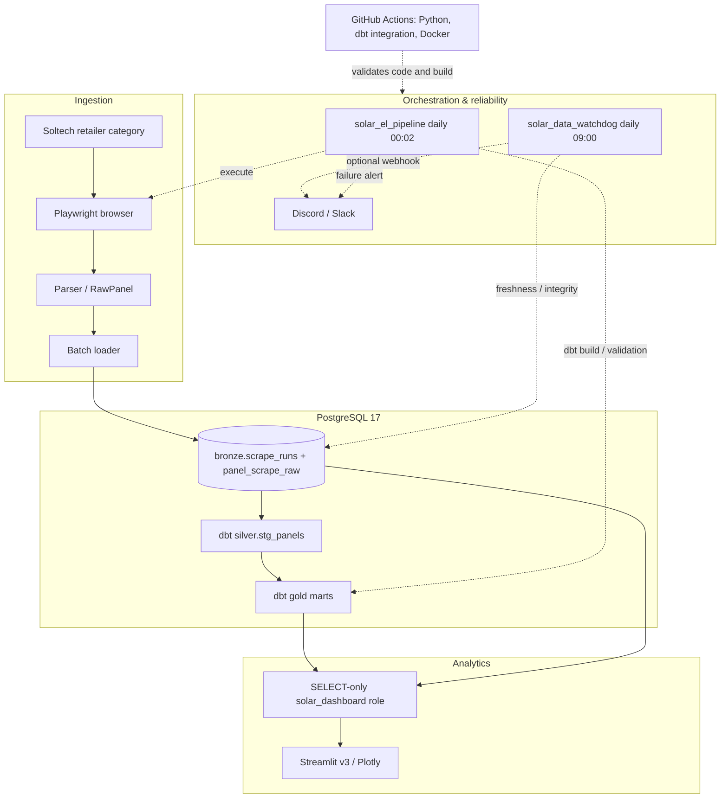

# Architecture — E2E Solar

_Last reviewed: 15 November 2026. Describes the verified repository structure and implemented local services; it is not a public production deployment._

## System overview

All four application services are provided by Docker Compose: `postgres`, `pgadmin`, `airflow`, `dashboard`. Local ports bind to `127.0.0.1` in the current Compose files.

## Runtime flow

1. Airflow (`airflow/dags/solar_pipeline.py`) schedules the main pipeline daily at **00:02 Europe/Warsaw**, with `catchup=False` and `max_active_runs=1`.
2. `scraper.main` creates a UUID for the scrape, marks its status `RUNNING`, extracts products, loads them into Bronze, then records `SUCCESS` and the count; failures update the run to `FAILED`.
3. `scraper.extractor` uses synchronous Playwright. It targets the product list, follows the next-page link, and rejects pagination loops, pages with no new products, and missing source URLs. `MAX_PAGES` is a fail-safe cap, not a fixed expected page count.
4. `dbt build` validates the latest successful run's count and URL integrity. Dependent models are skipped if the integrity gate fails; the Airflow task fails.
5. Silver normalizes data types and preserves successful-run history; Gold provides ranking, history and daily trends.
6. `scraper.validate` checks the latest run and ensures the Gold ranking is nonempty.
7. Streamlit queries Gold and selected Bronze metadata with a dedicated PostgreSQL login. The app itself does not perform scrapes or update records.
8. A separate watchdog DAG checks freshness (default **30 h**) and integrity at **09:00 Europe/Warsaw**. Optional webhook alerts can notify Discord or Slack.

## Contracts and grain

| Layer | Entity | Logical grain |
|---|---|---|
| Bronze runs | `scrape_runs` | One UUID per scrape |
| Bronze observations | `panel_scrape_raw` | One `scrape_id` per saved product observation |
| Silver | `stg_panels` | One typed observation per raw scrape row from a successful run |
| Gold ranking | `current_panel_ranking` | Latest successful snapshot, deduplicated by `source_url` |
| Gold history | `product_price_history` | One observation per (`scrape_run_id`, `source_url`) |
| Gold daily | `daily_market_prices` | One summary per observed date of available products |

Product identity in this MVP is the normalized product URL. A given URL appearing in different scrape runs is intentional; repetition within one run is an integrity violation.

## Test boundaries

- **Unit/regression:** pytest on Python parsing, dashboard transformations and offline Playwright HTML fixtures.
- **Data:** dbt source/model tests validate latest run and relevant invariants; SQL model dependencies prevent silently publishing invalid new observations.
- **Integration:** GitHub Actions provisions temporary PostgreSQL 17 and asserts expected model results on deterministic fixture observations.
- **Build:** GitHub Actions validates Compose and builds Streamlit/Airflow images, without connecting to the retailer.

## Deliberate limitations

- No guarantee of 24/7 execution when the user's workstation is asleep or Docker is stopped.
- Watchdog runs inside Airflow; loss of the scheduler/host requires an external monitor to detect.
- Airflow metadata uses embedded SQLite in this development setup.
- Database and other time fields are timezone-naive; UTC `TIMESTAMPTZ` migration needs an explicit plan.
- Source prices may be net or gross; source URLs can change; product power is derived from titles.
- A changing daily catalog means market averages are not fixed-cohort price indices.
- A public deployment needs security hardening, backups, and a distinct environment. See [Release checklist](release_checklist.md).
