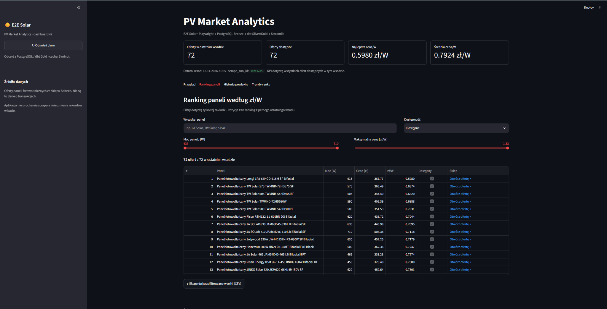
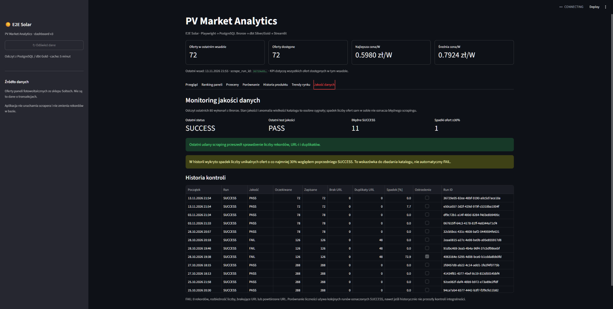

# Portfolio case study — E2E Solar Price Pipeline

## Business problem

Public photovoltaic-panel listings change in price, availability, and catalog composition. Manually collecting offers provides no reproducible historical record. This project builds a repeatable pipeline to track offer snapshots, compare price per rated watt, and detect changes over time.

## Scope and implementation

- **Extract:** Playwright visits the retailer's category, follows pagination, parses panel titles/prices/power/URL/availability.
- **Load:** Python persists raw observations plus one run record in PostgreSQL Bronze.
- **Transform:** dbt builds typed Silver observations, Gold rankings, historical changes and daily market indicators.
- **Orchestrate:** Apache Airflow runs the pipeline and a separate freshness/integrity watchdog.
- **Analyze:** Streamlit/Plotly provides ranking, per-product history, price drops, comparisons and a monitoring view.
- **Verify:** pytest/Chromium offline HTML regression tests, dbt assertions and three independent GitHub Actions jobs (Python, dbt+PostgreSQL, Docker).

## Example problem and solution

**Observed on 28 October 2026:** the store category had only four pages and 78 unique listings. The original scraper assumed 12 pages and queried URLs beyond the actual end, resulting in **126 rows including 48 redundant URL occurrences**. The dbt integrity test returned a failure, halting downstream processing.

**Resolution:** dynamic next-link navigation replaced the fixed page limit. Product URLs are deduplicated per run, pagination loops are rejected, and missing/duplicate URLs cause a quality failure. Offline Playwright fixtures now cover related regressions without requesting the real website.

**Tradeoff:** the platform does not hard-code 78 or 288 offers as an expected count. A sharp catalog-size change raises an **anomaly warning**, not an automatic data-integrity failure. This distinguishes changed retailer inventory from malformed extraction.

## Dashboard samples

_Example ranking uses PLN per rated watt. The offers are historical observations, not necessarily today's prices._

_Data quality monitoring separates invalid duplicate-containing runs from warnings about catalog size changes._

## Project outcomes and evidence

- Daily schedule and end-to-end Airflow execution confirmed in the local Docker Compose environment.
- 49 Python tests passed locally following the pagination regression suite (15 November 2026); subsequent alerting tests were added. The GitHub Actions pipeline independently validates Python, dbt and Docker.
- Models Gold provide read-only datasets for the dashboard; `solar_dashboard` is a separate SELECT-only database role.
- Failure notifications and a second daily freshness watchdog are implemented; the webhook integration is optional.

## Limitations and next improvements

- Gross/net price status has not been independently validated; module wattage is parsed from title text.
- URL-based product identity can break after a retailer changes URLs.
- Market averages use a changing set of available products, not a constant basket.
- 24/7 reliability is not guaranteed on a personal workstation; monitoring that runs inside Airflow cannot detect host shutdown.
- Before sharing a public demo: secure credentials, verify backups and restore, isolate production from development, add authentication and independent uptime monitoring.

## Interview explanation (short)

> I built an end-to-end ELT pipeline that uses Playwright to collect PV panel listings, stores historical snapshots in PostgreSQL, and builds tested analytical models with dbt. Airflow orchestrates the workflow and monitors data freshness, while Streamlit exposes ranking, price trends and anomaly indicators. A real pagination regression caused duplicate rows; the dbt quality gate caught it, and I fixed the extraction logic and added offline Chromium regression tests. GitHub Actions now validates Python, database transformations and Docker images on every push.
